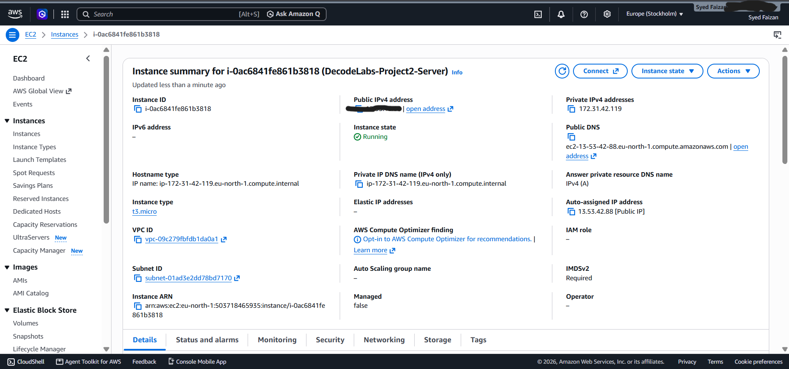
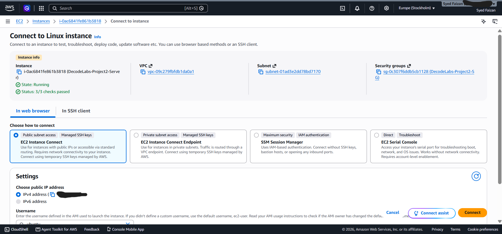
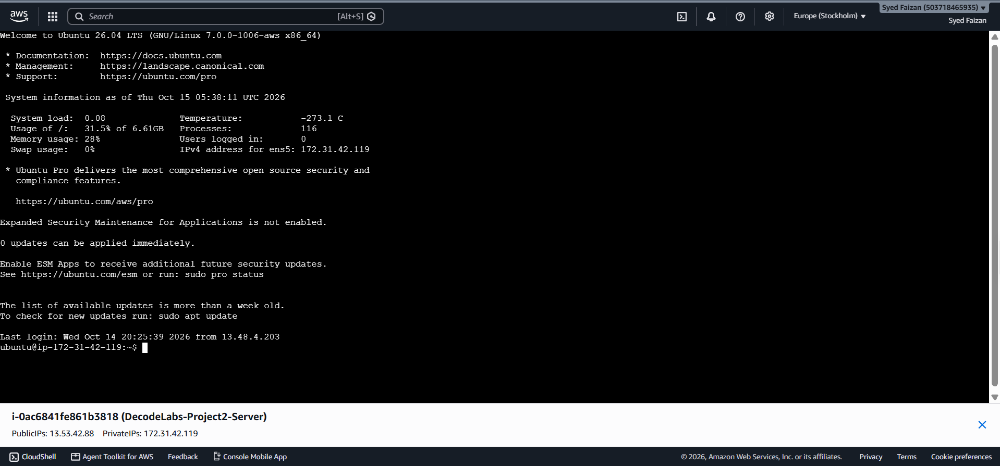
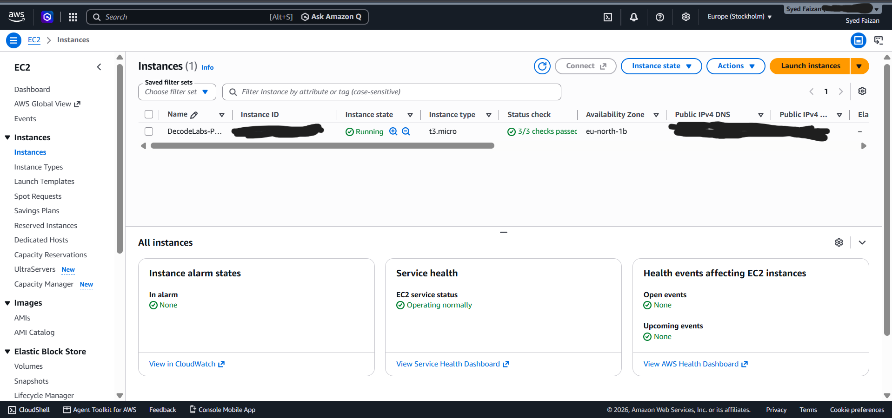
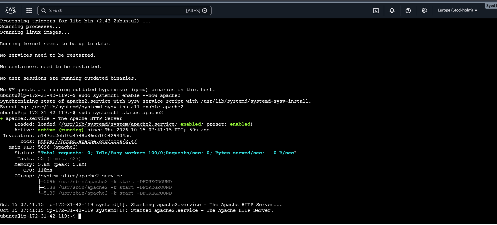
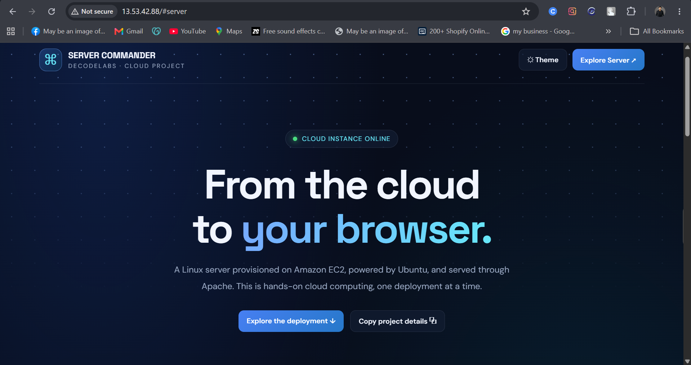

# The Server Commander | AWS EC2 & Linux

## Project Overview

**The Server Commander** is a hands-on cloud computing project completed as part of my **Cloud Computing Internship at DecodeLabs**.

The project focuses on launching and configuring an Ubuntu Linux virtual server on Amazon EC2, establishing remote access through AWS EC2 Instance Connect, configuring network access, and deploying a custom webpage using Apache HTTP Server.

## Technologies Used

- **Cloud Platform:** Amazon Web Services (AWS)
- **Compute Service:** Amazon EC2
- **Operating System:** Ubuntu Linux
- **Remote Access:** AWS EC2 Instance Connect / SSH
- **Web Server:** Apache HTTP Server
- **Networking:** AWS Security Groups
- **Web Technologies:** HTML

## Project Objectives

- Launch and configure a Linux EC2 instance.
- Understand EC2 instance states and system status checks.
- Configure inbound network rules using AWS Security Groups.
- Establish remote access to an Ubuntu Linux server.
- Install and configure Apache HTTP Server.
- Create and deploy a custom HTML welcome page.
- Verify public HTTP access to the hosted webpage.

## Implementation and Deployment

### 1. EC2 Instance Running

Launched an Ubuntu Linux EC2 instance and verified that the instance was running and its status checks had passed.

### 2. EC2 Connection Configuration

Reviewed the instance connection settings and associated security group configuration to understand the requirements for remote server access.

### 3. Ubuntu Terminal Access

Successfully accessed the Ubuntu Linux environment using AWS EC2 Instance Connect and executed commands to manage the cloud server.

### 4. EC2 Instances Dashboard

Reviewed the AWS EC2 dashboard to verify the instance details and its current running state.

### 5. Apache HTTP Server Status

Installed Apache HTTP Server and verified that the Apache service was active and running on the Ubuntu instance.

### 6. Live Webpage Deployment

Created a custom DecodeLabs welcome webpage and verified its accessibility through the EC2 instance's public IP address.

## Key Learnings

- Understanding AWS EC2 and cloud-based virtual machines.
- Working with Ubuntu Linux in a remote server environment.
- Establishing server access through browser-based SSH connectivity.
- Configuring AWS Security Groups and inbound network traffic.
- Installing and managing Apache HTTP Server.
- Deploying a custom HTML webpage on a cloud instance.
- Understanding the basic networking requirements for public website access.

## Security Considerations

- Restrict SSH access to trusted IP addresses whenever possible.
- Allow inbound HTTP traffic on port 80 when public website access is required.
- Avoid exposing unnecessary ports through security groups.
- Keep SSH private keys and other credentials secure.
- Monitor AWS resource usage to avoid unexpected charges.

## Future Improvements

- Configure HTTPS using an SSL/TLS certificate.
- Connect a custom domain name to the hosted webpage.
- Improve server security and implement regular system updates.
- Explore automated deployment using scripts and CI/CD pipelines.
- Learn production-ready cloud hosting and monitoring practices.

## Acknowledgement

This project was completed as part of my **Cloud Computing Internship at DecodeLabs**. It provided practical experience with AWS infrastructure, Linux server administration, network configuration, and the fundamentals of web server deployment.

## Project Details

| Category | Details |
|---|---|
| Project Name | The Server Commander |
| Domain | Cloud Computing |
| Cloud Platform | Amazon Web Services (AWS) |
| Compute Service | Amazon EC2 |
| Operating System | Ubuntu Linux |
| Web Server | Apache HTTP Server |
| Internship | DecodeLabs |

## Tags

#AWS #AmazonEC2 #Linux #Ubuntu #Apache #CloudComputing #DecodeLabs #DevOps
